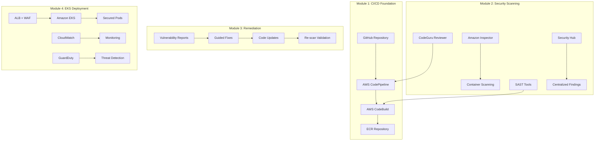

# Design Document

## Overview

The Juice Shop Security Workshop is designed as a focused 2.5-3 hour hands-on learning experience that demonstrates AWS DevSecOps practices using the OWASP Juice Shop application. The workshop emphasizes practical, immediate results through pre-configured infrastructure and guided exercises, allowing participants to experience the full security pipeline lifecycle in a compressed timeframe.

The workshop leverages AWS native security services including CodePipeline, CodeBuild, CodeGuru, Inspector, GuardDuty, and Security Hub, with emphasis on rapid deployment using Infrastructure as Code (CloudFormation/CDK) to maximize learning time while minimizing setup overhead.

## Architecture

### High-Level Architecture



### Module Structure (Total: 2.5-3 hours)

#### Module 1: DevSecOps Fundamentals & CI/CD Pipeline (45 minutes)
- **Theory (15 min)**: DevSecOps principles, shift-left security, CI/CD vs CI vs CD concepts
- **Hands-on (30 min)**: Create CodePipeline with CodeBuild for Juice Shop
- **Key Concepts**: Pipeline stages, build specifications, artifact management
- **Deliverable**: Working CI/CD pipeline that builds and stores container images
- **Learning Outcome**: Understand why automation and early integration matter

#### Module 2: Security Scanning & Vulnerability Management (45 minutes)
- **Theory (15 min)**: SAST vs DAST vs SCA, vulnerability scoring (CVSS), security gates
- **Hands-on (30 min)**: Integrate CodeGuru, Inspector, and Security Hub into pipeline
- **Key Concepts**: Security findings interpretation, risk assessment, compliance reporting
- **Deliverable**: Pipeline with automated security scanning and reporting
- **Learning Outcome**: Understand different types of security testing and their value

#### Module 3: Security Remediation & Secure Coding (45 minutes)
- **Theory (15 min)**: Common web vulnerabilities (OWASP Top 10), secure coding practices
- **Hands-on (30 min)**: Fix SQL injection, XSS, and authentication issues in Juice Shop
- **Key Concepts**: Vulnerability root causes, remediation strategies, security testing
- **Deliverable**: Hardened application with reduced critical vulnerabilities
- **Learning Outcome**: Practical experience fixing real security issues

#### Module 4: Container Security & Production Deployment (45 minutes)
- **Theory (15 min)**: Container security, Kubernetes security model, runtime protection
- **Hands-on (30 min)**: Deploy to EKS with Pod Security Standards, Network Policies, WAF
- **Key Concepts**: Defense in depth, least privilege, monitoring and alerting
- **Deliverable**: Production-ready deployment with comprehensive security controls
- **Learning Outcome**: Understand production security requirements and implementation

## Components and Interfaces

### AWS Services Integration

#### CodePipeline Configuration
```yaml
Pipeline Stages:
  1. Source (GitHub/CodeCommit)
  2. Build (CodeBuild with security scanning)
  3. Security Gate (Manual approval based on scan results)
  4. Deploy to Staging (EKS staging environment)
  5. Production Gate (Manual approval)
  6. Deploy to Production (EKS production environment)
```

#### Security Scanning Stack
- **CodeGuru Reviewer**: Automated code review for security and quality issues
- **Amazon Inspector**: Container and EC2 instance vulnerability assessment
- **Third-party SAST**: Integration with tools like SonarQube or Checkmarx
- **Container Scanning**: ECR native vulnerability scanning
- **Security Hub**: Centralized security findings aggregation

#### EKS Security Configuration
- **Pod Security Standards**: Enforce restricted security policies
- **Network Policies**: Implement microsegmentation
- **RBAC**: Role-based access control for cluster resources
- **Secrets Management**: AWS Secrets Manager integration
- **Service Mesh**: Optional Istio integration for advanced security

### Workshop Infrastructure

#### Participant Environment Setup
- **AWS Account**: Sandbox account with limited permissions
- **IAM Roles**: Pre-configured roles for workshop activities
- **Resource Limits**: Cost controls and resource quotas
- **Cleanup Automation**: Automated resource cleanup scripts

#### Content Delivery
- **Workshop Guide**: Step-by-step instructions with screenshots
- **Code Templates**: Pre-built CloudFormation/CDK templates
- **Sample Configurations**: Example security policies and configurations
- **Troubleshooting Guide**: Common issues and solutions

## Data Models

### Security Findings Schema
```typescript
interface SecurityFinding {
  id: string;
  severity: 'CRITICAL' | 'HIGH' | 'MEDIUM' | 'LOW' | 'INFORMATIONAL';
  source: 'CodeGuru' | 'Inspector' | 'SAST' | 'Container-Scan';
  title: string;
  description: string;
  remediation: string;
  cwe?: string;
  cvss?: number;
  location: {
    file: string;
    line?: number;
    function?: string;
  };
  status: 'NEW' | 'ACKNOWLEDGED' | 'RESOLVED' | 'SUPPRESSED';
}
```

### Pipeline Configuration
```typescript
interface PipelineConfig {
  name: string;
  source: {
    provider: 'GitHub' | 'CodeCommit';
    repository: string;
    branch: string;
  };
  buildSpec: {
    version: string;
    phases: BuildPhase[];
    artifacts: ArtifactConfig;
  };
  securityGates: SecurityGate[];
  deploymentTargets: DeploymentTarget[];
}
```

### EKS Cluster Configuration
```typescript
interface EKSClusterConfig {
  name: string;
  version: string;
  nodeGroups: NodeGroupConfig[];
  securityPolicies: {
    podSecurityStandards: 'privileged' | 'baseline' | 'restricted';
    networkPolicies: NetworkPolicy[];
    rbacRules: RBACRule[];
  };
  addons: {
    awsLoadBalancerController: boolean;
    efsCSIDriver: boolean;
    guardDuty: boolean;
  };
}
```

## Error Handling

### Pipeline Failure Scenarios
1. **Build Failures**: Clear error messages with suggested fixes
2. **Security Gate Failures**: Detailed vulnerability reports with remediation guidance
3. **Deployment Failures**: Kubernetes-specific error interpretation
4. **Resource Limits**: Graceful handling of AWS service limits

### Security Scanning Error Handling
1. **Scanner Unavailability**: Fallback mechanisms and retry logic
2. **False Positives**: Guidance on suppression and whitelisting
3. **Integration Failures**: Troubleshooting steps for service integrations
4. **Timeout Handling**: Appropriate timeouts for long-running scans

### Workshop Environment Issues
1. **Permission Errors**: Clear IAM troubleshooting steps
2. **Resource Conflicts**: Automated conflict resolution
3. **Cost Overruns**: Automatic resource cleanup triggers
4. **Network Issues**: VPC and security group troubleshooting

## Testing Strategy

### Module Testing Approach
1. **Unit Tests**: Individual component functionality
2. **Integration Tests**: End-to-end pipeline testing
3. **Security Tests**: Vulnerability scanning validation
4. **Performance Tests**: Pipeline execution time optimization

### Workshop Validation
1. **Dry Runs**: Complete workshop execution in test environments
2. **Participant Feedback**: Iterative improvement based on feedback
3. **Technical Validation**: Expert review of security configurations
4. **Accessibility Testing**: Ensure content is accessible to all skill levels

### Automated Testing
```yaml
Test Scenarios:
  - Pipeline Creation and Execution
  - Security Scanning Integration
  - Vulnerability Detection and Reporting
  - EKS Cluster Deployment
  - Application Accessibility
  - Resource Cleanup Verification
```

## Security Considerations

### Workshop Security
- **Sandboxed Environments**: Isolated AWS accounts for participants
- **Permission Boundaries**: Strict IAM policies preventing privilege escalation
- **Resource Monitoring**: Real-time monitoring of resource usage
- **Data Protection**: No sensitive data in workshop materials

### Application Security
- **Container Security**: Distroless base images and minimal attack surface
- **Runtime Security**: Pod security contexts and AppArmor profiles
- **Network Security**: Service mesh and network policies
- **Secrets Management**: Proper handling of sensitive configuration

### Compliance Considerations
- **Audit Logging**: Complete audit trail of all activities
- **Compliance Frameworks**: Alignment with SOC 2, PCI DSS principles
- **Data Residency**: Regional deployment considerations
- **Retention Policies**: Appropriate log and data retention

## Implementation Phases

### Phase 1: Infrastructure Setup (Week 1-2)
- AWS account setup and IAM configuration
- Base infrastructure deployment (VPC, EKS, etc.)
- CI/CD pipeline template creation
- Security tooling integration

### Phase 2: Content Development (Week 3-5)
- Workshop guide creation with step-by-step instructions
- Code template and configuration development
- Security scenario creation and testing
- Troubleshooting guide development

### Phase 3: Testing and Validation (Week 6-7)
- End-to-end workshop testing
- Security validation and penetration testing
- Performance optimization
- Documentation review and updates

### Phase 4: Deployment and Launch (Week 8)
- Production environment setup
- Participant onboarding materials
- Instructor training materials
- Launch and feedback collection